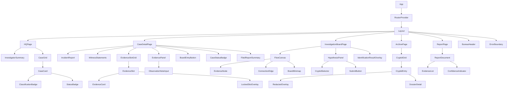
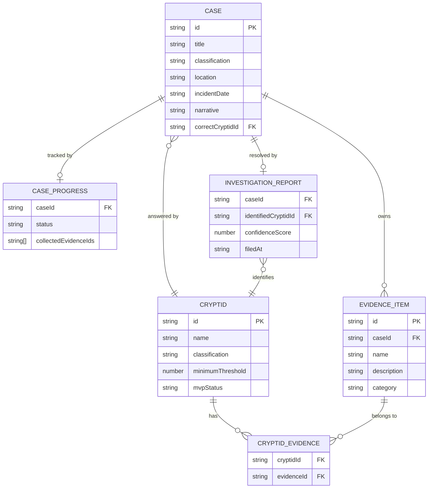
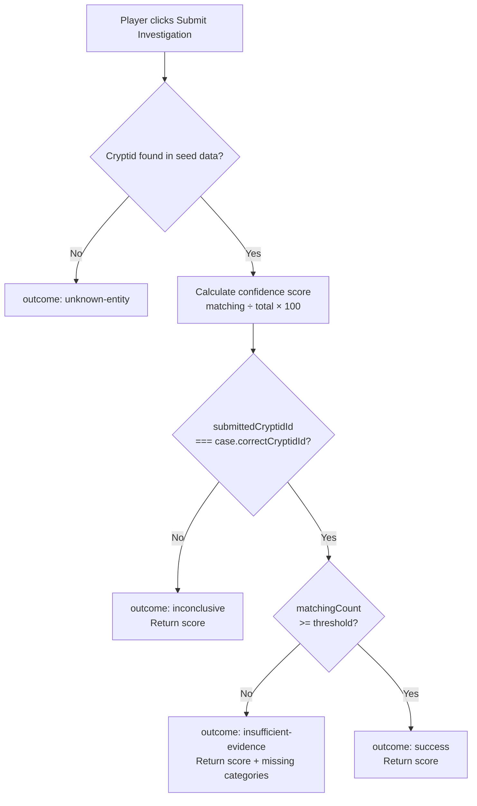
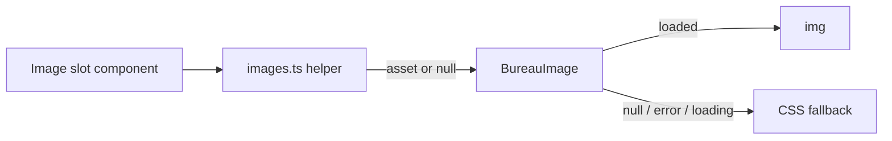

# Design Document

## Cryptid Casefiles

---

## Overview

Cryptid Casefiles is a browser-based supernatural investigation game running entirely client-side. Players act as field investigators for a fictional paranormal research bureau, working through classified cases, collecting evidence, connecting clues on a React Flow canvas, and identifying unknown cryptids. All game state is persisted to LocalStorage; there is no backend.

The architecture follows a strict layered separation: static seed data is consumed by a pure engine/services layer, which is surfaced to the UI through a Zustand store, and rendered by React components. Game logic never leaks into components, and no component encodes case-specific knowledge.

---

## Architecture

### Layered Architecture

```
┌─────────────────────────────────────────────────────────────┐
│  UI Layer (React components + pages)                        │
│  Pages: HQ, CaseDetail, InvestigationBoard, Archive, Report │
│  Components: CaseCard, EvidenceCard, CryptidEntry, …        │
├─────────────────────────────────────────────────────────────┤
│  Store Layer (Zustand)                                      │
│  caseSlice · evidenceSlice · boardSlice                     │
│  archiveSlice · reportSlice                                 │
│  + persistence middleware (LocalStorage sync)               │
├─────────────────────────────────────────────────────────────┤
│  Services / Engine Layer (pure functions)                   │
│  identificationEngine · reportBuilder · persistenceService  │
│  scoreCalculator · validationService                        │
├─────────────────────────────────────────────────────────────┤
│  Data Layer (static, typed seed data)                       │
│  cases.ts · evidence.ts · cryptids.ts                       │
│  Initial game content — never mutated at runtime            │
└─────────────────────────────────────────────────────────────┘
```

### Component Hierarchy



**Page-level components** (`pages/`): `HQPage`, `CaseDetailPage`, `InvestigationBoardPage`, `ArchivePage`, `ReportPage`

**Feature-level components** (`components/features/`): `CaseCard`, `EvidenceSlot`, `EvidenceCard`, `EvidencePanel`, `FlowCanvas`, `EvidenceNode`, `ConnectionEdge`, `HypothesisPanel`, `CryptidEntry`, `ReportDocument`

**Shared/atomic components** (`components/ui/`): `ClassificationBadge`, `StatusBadge`, `BureauHeader`, `ConfidenceIndicator`, `ObservationNoteInput`, `RedactedOverlay`, `Tooltip`

---

## Components and Interfaces

### Folder and File Structure

```
src/
├── main.tsx                         # Vite entry point
├── App.tsx                          # Router provider + store hydration
├── router.tsx                       # createBrowserRouter configuration
│
├── data/                            # Static typed seed data — never mutated
│   ├── cases.ts                     # All three Case records
│   ├── evidence.ts                  # All twelve EvidenceItem records
│   └── cryptids.ts                  # All five Cryptid records
│
├── types/                           # TypeScript interfaces and enums
│   ├── domain.ts                    # Case, EvidenceItem, Cryptid
│   ├── board.ts                     # EvidenceNode, EvidenceConnection
│   ├── progress.ts                  # CaseProgress, UserProgress
│   ├── report.ts                    # InvestigationReport
│   └── identification.ts            # IdentificationResult, outcome unions
│
├── store/                           # Zustand store
│   ├── index.ts                     # Composed store with persistence middleware
│   ├── slices/
│   │   ├── caseSlice.ts
│   │   ├── evidenceSlice.ts
│   │   ├── boardSlice.ts
│   │   ├── archiveSlice.ts
│   │   └── reportSlice.ts
│   └── middleware/
│       └── persistenceMiddleware.ts
│
├── services/                        # Pure engine/service functions
│   ├── identificationEngine.ts      # Two-step identification logic
│   ├── scoreCalculator.ts           # Confidence score formula
│   ├── reportBuilder.ts             # Assembles InvestigationReport
│   ├── persistenceService.ts        # LocalStorage read/write/validate
│   └── validationService.ts         # Schema version and shape checks
│
├── pages/                           # Route-level page components
│   ├── HQPage.tsx
│   ├── CaseDetailPage.tsx
│   ├── InvestigationBoardPage.tsx
│   ├── ArchivePage.tsx
│   └── ReportPage.tsx
│
├── components/
│   ├── features/                    # Feature-scoped components
│   │   ├── hq/
│   │   │   ├── CaseCard.tsx
│   │   │   ├── CaseGrid.tsx
│   │   │   └── InvestigatorSummary.tsx
│   │   ├── case/
│   │   │   ├── IncidentReport.tsx
│   │   │   ├── WitnessStatements.tsx
│   │   │   ├── EvidenceSlotGrid.tsx
│   │   │   ├── EvidenceSlot.tsx
│   │   │   ├── EvidenceCard.tsx
│   │   │   ├── EvidencePanel.tsx
│   │   │   ├── ObservationNoteInput.tsx
│   │   │   └── FiledReportSummary.tsx
│   │   ├── board/
│   │   │   ├── FlowCanvas.tsx
│   │   │   ├── EvidenceNode.tsx
│   │   │   ├── ConnectionEdge.tsx
│   │   │   └── BoardMinimap.tsx
│   │   ├── hypothesis/
│   │   │   ├── HypothesisPanel.tsx
│   │   │   ├── CryptidSelector.tsx
│   │   │   └── IdentificationResultOverlay.tsx
│   │   ├── archive/
│   │   │   ├── CryptidGrid.tsx
│   │   │   ├── CryptidEntry.tsx
│   │   │   └── DossierDetail.tsx
│   │   └── report/
│   │       ├── ReportDocument.tsx
│   │       └── ConfidenceIndicator.tsx
│   └── ui/                          # Shared atomic components
│       ├── BureauHeader.tsx
│       ├── ClassificationBadge.tsx
│       ├── StatusBadge.tsx
│       ├── RedactedOverlay.tsx
│       ├── Tooltip.tsx
│       └── ProgressResetModal.tsx
│
├── hooks/                           # Custom React hooks
│   ├── useCaseProgress.ts           # Per-case derived state
│   ├── useEvidenceCollection.ts     # Collection action + animation trigger
│   ├── useBoardSync.ts              # React Flow ↔ store synchronisation
│   └── useHydration.ts              # Wait for store hydration before render
│
└── utils/
    ├── cn.ts                        # Tailwind class merging utility
    └── formatDate.ts                # Date formatting for report timestamps
```

### TypeScript Interfaces

```typescript
// ─── types/domain.ts ────────────────────────────────────────────────────────

/** Classification security level displayed on all case materials. */
export type ClassificationLevel =
  | 'LEVEL 1 — UNCLASSIFIED'
  | 'LEVEL 2 — RESTRICTED'
  | 'LEVEL 3 — RESTRICTED'
  | 'LEVEL 4 — CONFIDENTIAL'
  | 'LEVEL 5 — EYES ONLY';

/** A witness attached to a specific case incident report. */
export interface WitnessStatement {
  /** Witness display name or role description. */
  witness: string;
  statement: string;
}

/** A single playable investigation case. All fields are static seed data. */
export interface Case {
  /** Unique identifier, e.g. "case-001". */
  id: string;
  title: string;
  classification: ClassificationLevel;
  location: string;
  /** Display date of the incident, e.g. "October 14". */
  incidentDate: string;
  narrative: string;
  witnessStatements: WitnessStatement[];
  /** Ordered list of evidence IDs belonging to this case. */
  evidenceIds: string[];
  /** The single correct cryptid ID for this case. */
  correctCryptidId: string;
}

/** A collectible field report artifact. All fields are static seed data. */
export interface EvidenceItem {
  /** Unique identifier, e.g. "EV-001". */
  id: string;
  /** The case this evidence belongs to. */
  caseId: string;
  name: string;
  description: string;
  /**
   * Broad category label used in "Insufficient Evidence" feedback
   * (e.g. "Physical Trace", "Sensor Data", "Biological").
   * Allows the UI to describe missing evidence categories without
   * naming specific uncollected items.
   */
  category: string;
}

/**
 * One of the five supernatural entities in the game.
 * archive-only cryptids (cryptid-004, cryptid-005) have no evidence
 * and no threshold; their mvpStatus encodes this permanently.
 */
export interface Cryptid {
  /** Unique identifier, e.g. "cryptid-001". */
  id: string;
  name: string;
  classification: string;
  description: string;
  behaviour: string;
  loreExcerpt: string;
  /** Evidence IDs whose collection contributes to this cryptid's score. */
  associatedEvidenceIds: string[];
  /**
   * Minimum number of matching evidence items required for a successful
   * identification. Null for archive-only cryptids that cannot be identified.
   */
  minimumThreshold: number | null;
  /**
   * "playable" — can be identified via case submission.
   * "archive-only" — permanently locked in the Archive; no identification path.
   */
  mvpStatus: 'playable' | 'archive-only';
}


// ─── types/board.ts ─────────────────────────────────────────────────────────

import type { Node, Edge } from '@xyflow/react';

/**
 * The data payload stored inside a React Flow Node for evidence items.
 * The full EvidenceItem is embedded so the node component needs no store lookup.
 */
export interface EvidenceNodeData {
  evidenceId: string;
  evidenceName: string;
  evidenceCategory: string;
  isSelected: boolean;
}

/** React Flow Node parameterised with our evidence data. */
export type EvidenceNode = Node<EvidenceNodeData, 'evidence'>;

/**
 * The data payload stored inside a React Flow Edge for investigator connections.
 */
export interface EvidenceConnectionData {
  /** Optional investigator note, max 80 characters. */
  label: string;
}

/** React Flow Edge parameterised with our connection data. */
export type EvidenceConnection = Edge<EvidenceConnectionData>;


// ─── types/progress.ts ──────────────────────────────────────────────────────

/**
 * Lifecycle status of a single case.
 * - new: never opened
 * - in-progress: opened or submitted at least once without correct identification
 * - identified: correct cryptid submitted, awaiting "File Report" click
 * - closed: report filed; board and hypothesis locked
 */
export type CaseStatus = 'new' | 'in-progress' | 'identified' | 'closed';

/** Persisted per-case runtime state. */
export interface CaseProgress {
  caseId: string;
  status: CaseStatus;
  /** IDs of collected evidence items for this case. */
  collectedEvidenceIds: string[];
  /** Map of evidenceId → observation note text. */
  observationNotes: Record<string, string>;
  /** React Flow node positions keyed by evidenceId. */
  nodePositions: Record<string, { x: number; y: number }>;
  /** All edges on the board for this case. */
  connections: EvidenceConnection[];
}

/** Top-level persisted state stored under the namespaced LocalStorage key. */
export interface UserProgress {
  /** Schema version; mismatch triggers full reset. */
  schemaVersion: string;
  /** Per-case progress keyed by caseId. */
  cases: Record<string, CaseProgress>;
  /** Set of cryptid IDs that have been successfully identified. */
  unlockedCryptidIds: string[];
  /** Filed investigation reports keyed by caseId. */
  reports: Record<string, InvestigationReport>;
}


// ─── types/report.ts ────────────────────────────────────────────────────────

/** Snapshot of a collected evidence item captured at report filing time. */
export interface ReportEvidenceEntry {
  evidenceId: string;
  name: string;
  description: string;
  /** Observation note at the time the report was filed. */
  observationNote: string;
}

/** Immutable record generated when a player files a correct identification. */
export interface InvestigationReport {
  caseId: string;
  caseTitle: string;
  /** ISO 8601 date string of when the report was filed. */
  filedAt: string;
  identifiedCryptidId: string;
  identifiedCryptidName: string;
  /** Confidence score 0–100, rounded to nearest integer. */
  confidenceScore: number;
  collectedEvidence: ReportEvidenceEntry[];
}


// ─── types/identification.ts ─────────────────────────────────────────────────

/**
 * All possible outcomes from the identification engine.
 * - success: correct cryptid AND threshold met → can file report
 * - inconclusive: wrong cryptid selected
 * - insufficient-evidence: correct cryptid but threshold not met
 * - unknown-entity: edge case — cryptid not found in seed data (defensive)
 */
export type IdentificationOutcome =
  | 'success'
  | 'inconclusive'
  | 'insufficient-evidence'
  | 'unknown-entity';

/** Full result object returned by the identification engine. */
export interface IdentificationResult {
  outcome: IdentificationOutcome;
  /** The confidence score is always calculated and returned, regardless of outcome. */
  confidenceScore: number;
  /** Number of collected evidence IDs that intersect with the cryptid's set. */
  matchingEvidenceCount: number;
  /**
   * For 'insufficient-evidence': evidence categories that are entirely
   * unrepresented in the player's collected set, without naming specific items.
   */
  missingCategories: string[];
  /** The cryptid ID that was submitted. */
  submittedCryptidId: string;
}
```

---

## Data Models

### Entity Relationships



### Cross-Reference at Runtime

All data relationships are expressed as ID references. There are no circular imports between the data layer and the type layer. At runtime the identification engine, score calculator, and report builder receive the necessary slices of seed data as explicit parameters rather than importing global state.

- A `Case` record holds `evidenceIds: string[]` — the ordered list of evidence IDs for that case — and `correctCryptidId: string` — the single correct answer.
- A `Cryptid` record holds `associatedEvidenceIds: string[]` — the evidence set used for scoring. For playable cryptids this set equals the evidence IDs of their associated case; the engine uses this set for the confidence score formula.
- An `EvidenceItem` holds `caseId` for direct case membership and `category` for "missing evidence" feedback, but does not embed cryptid references — the cryptid's `associatedEvidenceIds` is the authoritative join.
- At identification time, the engine receives: `submittedCryptidId`, `collectedEvidenceIds` for the active case, the full `Cryptid` seed record for the submitted cryptid, and the `correctCryptidId` from the active `Case`. No other data is required.

---

## Zustand Store Design

### Store Shape

```typescript
// store/index.ts — composed store interface

interface AppStore
  extends CaseSlice,
    EvidenceSlice,
    BoardSlice,
    ArchiveSlice,
    ReportSlice {}
```

### Slice Interfaces

```typescript
// ─── CaseSlice ──────────────────────────────────────────────────────────────
interface CaseSlice {
  /** Runtime case status map, keyed by caseId. */
  caseStatuses: Record<string, CaseStatus>;

  setCaseStatus: (caseId: string, status: CaseStatus) => void;
  resetAllCases: () => void;
}

// ─── EvidenceSlice ───────────────────────────────────────────────────────────
interface EvidenceSlice {
  /** Map of caseId → set of collected evidenceIds. */
  collectedEvidence: Record<string, Set<string>>;
  /** Map of evidenceId → observation note text. */
  observationNotes: Record<string, string>;

  collectEvidence: (caseId: string, evidenceId: string) => void;
  saveObservationNote: (evidenceId: string, note: string) => void;
  resetAllEvidence: () => void;
}

// ─── BoardSlice ──────────────────────────────────────────────────────────────
interface BoardSlice {
  /**
   * Node positions keyed as `${caseId}:${evidenceId}`.
   * Only position (x, y) is persisted; React Flow node identity is
   * reconstructed from the evidence collection state.
   */
  nodePositions: Record<string, { x: number; y: number }>;
  /** Edges keyed by caseId. */
  connections: Record<string, EvidenceConnection[]>;

  updateNodePosition: (caseId: string, evidenceId: string, x: number, y: number) => void;
  addConnection: (caseId: string, edge: EvidenceConnection) => void;
  removeConnection: (caseId: string, edgeId: string) => void;
  updateConnectionLabel: (caseId: string, edgeId: string, label: string) => void;
  resetBoard: (caseId: string) => void;
  resetAllBoards: () => void;
}

// ─── ArchiveSlice ────────────────────────────────────────────────────────────
interface ArchiveSlice {
  /** Set of cryptid IDs that have been successfully identified. */
  unlockedCryptidIds: Set<string>;

  unlockCryptid: (cryptidId: string) => void;
  resetArchive: () => void;
}

// ─── ReportSlice ─────────────────────────────────────────────────────────────
interface ReportSlice {
  /** Filed investigation reports keyed by caseId. */
  reports: Record<string, InvestigationReport>;
  /**
   * The most recent identification result for the active case.
   * Not persisted — reconstructed on re-submission.
   */
  lastIdentificationResult: IdentificationResult | null;

  fileReport: (report: InvestigationReport) => void;
  setLastIdentificationResult: (result: IdentificationResult | null) => void;
  resetAllReports: () => void;
}
```

### Persistence Middleware

The persistence middleware is a Zustand middleware that intercepts every `setState` call. After each mutation it schedules a debounced write to LocalStorage with a 500ms delay. If another mutation fires within that window, the timer resets, ensuring the write reflects the latest state. On the leading edge of any mutation the middleware tags the write as pending; the actual write uses `JSON.stringify` on the serialisable subset of state (Sets are converted to arrays before serialisation).

```typescript
// store/middleware/persistenceMiddleware.ts (outline)

const STORAGE_KEY = 'cryptid-casefiles-v1';
const WRITE_DEBOUNCE_MS = 500;

function persistenceMiddleware<T extends AppStore>(
  config: StateCreator<T>
): StateCreator<T> {
  return (set, get, api) =>
    config(
      (partial, replace) => {
        set(partial, replace as false);
        scheduleWrite(get);
      },
      get,
      api
    );
}
```

Actions that mutate state and therefore trigger a persistence write:
`collectEvidence`, `saveObservationNote`, `setCaseStatus`, `updateNodePosition`, `addConnection`, `removeConnection`, `updateConnectionLabel`, `unlockCryptid`, `fileReport`, `resetAllCases`, `resetAllEvidence`, `resetAllBoards`, `resetArchive`, `resetAllReports`.

Read-only selectors and `setLastIdentificationResult` (ephemeral UI state) do not trigger persistence.

---

## LocalStorage Persistence Strategy

### Persisted vs. Derived State

| State | Persisted | Reason |
|---|---|---|
| `caseStatuses` | ✅ | Core progression |
| `collectedEvidence` (as arrays) | ✅ | Core progression |
| `observationNotes` | ✅ | Player-authored content |
| `nodePositions` | ✅ | Board layout |
| `connections` | ✅ | Board layout |
| `unlockedCryptidIds` (as arrays) | ✅ | Core progression |
| `reports` | ✅ | Immutable game records |
| `lastIdentificationResult` | ❌ | Ephemeral UI state |
| Seed data (cases, evidence, cryptids) | ❌ | Always in bundle |
| Derived counts (closedCaseCount, etc.) | ❌ | Computed from persisted state |

### Persisted Schema

```typescript
interface PersistedState {
  schemaVersion: string;                             // e.g. "1"
  caseStatuses: Record<string, CaseStatus>;
  collectedEvidence: Record<string, string[]>;       // Set → array
  observationNotes: Record<string, string>;
  nodePositions: Record<string, { x: number; y: number }>;
  connections: Record<string, EvidenceConnection[]>;
  unlockedCryptidIds: string[];                      // Set → array
  reports: Record<string, InvestigationReport>;
}
```

### Schema Version Check and Fallback

```pseudocode
CURRENT_SCHEMA_VERSION = "1"
STORAGE_KEY = "cryptid-casefiles-v1"

function loadPersistedState() -> PersistedState | null:
  raw = localStorage.getItem(STORAGE_KEY)
  if raw is null:
    return null                           // No data → fresh state

  try:
    parsed = JSON.parse(raw)
  catch:
    console.warn("LocalStorage parse error — resetting")
    return null                           // Corrupt JSON → fresh state

  if parsed.schemaVersion !== CURRENT_SCHEMA_VERSION:
    console.warn("Schema version mismatch — resetting")
    localStorage.removeItem(STORAGE_KEY)
    return null                           // Version mismatch → fresh state

  if not isValidPersistedShape(parsed):
    console.warn("Unexpected data shape — resetting")
    return null                           // Shape invalid → fresh state

  return parsed                           // Valid → hydrate store

function isValidPersistedShape(data: unknown) -> boolean:
  return (
    typeof data === 'object' &&
    'schemaVersion' in data &&
    'caseStatuses' in data &&
    'collectedEvidence' in data &&
    'unlockedCryptidIds' in data &&
    'reports' in data
  )
```

### Write Strategy

Writes are debounced at the middleware level with a 500ms window. The write serialises the full `PersistedState` snapshot atomically — there are no partial key writes. On reset, the key is explicitly removed before re-initialising to avoid stale fragments.

### Hydration Timing

`App.tsx` calls `persistenceService.loadPersistedState()` synchronously before the first React render. If valid data is returned, the Zustand store is initialised with that data. If null is returned, the store initialises with its default empty state. The `useHydration` hook gates all interactive page rendering until the store has been initialised, preventing flashes of incorrect state.

---

## React Router Route Structure

### Route Configuration

```typescript
// router.tsx

const router = createBrowserRouter([
  {
    path: '/',
    element: <Layout />,
    errorElement: <ErrorBoundary />,
    children: [
      {
        index: true,
        element: <HQPage />,
      },
      {
        path: 'case/:caseId',
        element: <CaseDetailPage />,
        loader: caseDetailLoader,   // validates caseId, redirects to / if invalid
      },
      {
        path: 'case/:caseId/board',
        element: <InvestigationBoardPage />,
        loader: boardLoader,        // guards: caseId valid + case not closed
      },
      {
        path: 'case/:caseId/report',
        element: <ReportPage />,
        loader: reportLoader,       // guards: report exists for caseId
      },
      {
        path: 'archive',
        element: <ArchivePage />,
      },
      {
        path: '*',
        element: <Navigate to="/" replace />,
      },
    ],
  },
]);
```

### Route Guards (Loaders)

```typescript
// caseDetailLoader: validates caseId
function caseDetailLoader({ params }: LoaderFunctionArgs) {
  const { caseId } = params;
  if (!CASES.find(c => c.id === caseId)) {
    throw redirect('/');
  }
  return null;
}

// boardLoader: validates caseId AND guards closed cases
function boardLoader({ params }: LoaderFunctionArgs) {
  const { caseId } = params;
  if (!CASES.find(c => c.id === caseId)) {
    throw redirect('/');
  }
  const status = store.getState().caseStatuses[caseId];
  if (status === 'closed') {
    throw redirect(`/case/${caseId}`);
  }
  return null;
}

// reportLoader: guards missing reports
function reportLoader({ params }: LoaderFunctionArgs) {
  const { caseId } = params;
  const report = store.getState().reports[caseId];
  if (!report) {
    throw redirect(`/case/${caseId}`);
  }
  return null;
}
```

### Breadcrumb / Navigation State

`BureauHeader` reads the current route via `useLocation()` and `useParams()` to derive the breadcrumb trail:

| Route | Breadcrumb |
|---|---|
| `/` | `BUREAU HQ` |
| `/case/:caseId` | `BUREAU HQ › CASE {caseId.toUpperCase()}` |
| `/case/:caseId/board` | `BUREAU HQ › CASE {caseId.toUpperCase()} › INVESTIGATION BOARD` |
| `/case/:caseId/report` | `BUREAU HQ › CASE {caseId.toUpperCase()} › FILED REPORT` |
| `/archive` | `BUREAU HQ › CRYPTID ARCHIVE` |

---

## React Flow Evidence Board Implementation

### Node Construction

Each collected evidence item is mapped to a React Flow `Node` object. This mapping is performed inside the `useBoardSync` hook, which subscribes to both the evidence collection state and the persisted node positions.

```typescript
function buildNodes(
  collectedIds: string[],
  evidenceItems: EvidenceItem[],
  nodePositions: Record<string, { x: number; y: number }>,
  caseId: string
): EvidenceNode[] {
  return collectedIds.map((id, index) => {
    const item = evidenceItems.find(e => e.id === id)!;
    const posKey = `${caseId}:${id}`;
    const position = nodePositions[posKey] ?? defaultGridPosition(index);
    return {
      id,
      type: 'evidence',
      position,
      data: {
        evidenceId: id,
        evidenceName: item.name,
        evidenceCategory: item.category,
        isSelected: false,
      },
    };
  });
}

// Default grid layout for first open
function defaultGridPosition(index: number): { x: number; y: number } {
  const COLS = 2;
  const H_GAP = 280;
  const V_GAP = 180;
  return {
    x: (index % COLS) * H_GAP + 40,
    y: Math.floor(index / COLS) * V_GAP + 40,
  };
}
```

### Edge Construction

Persisted `EvidenceConnection` objects (which are typed React Flow `Edge` values) are passed directly to React Flow's `edges` prop after retrieval from the store. No transformation is needed; the store stores them in React Flow's native format.

### Custom Node Component

```typescript
// components/features/board/EvidenceNode.tsx

interface EvidenceNodeProps {
  data: EvidenceNodeData;
}

export function EvidenceNode({ data }: EvidenceNodeProps) {
  // Renders: evidence name, category badge, connection handles (top + bottom)
  // Styled as a weathered field report card (parchment surface)
  // Uses Handle from @xyflow/react for source/target connection points
}
```

### Node Position Updates

React Flow fires `onNodesChange` for every positional drag event. The `FlowCanvas` component filters these changes for type `'position'` and calls `updateNodePosition(caseId, nodeId, x, y)` on the store. The middleware debounces the LocalStorage write.

### Edge Validation and Creation

React Flow fires `onConnect` when the user completes a drag between two handles. Before adding to the store, the `FlowCanvas` applies two synchronous guards:

```pseudocode
function onConnect(connection: Connection):
  if connection.source === connection.target:
    return   // Self-loop — reject silently

  existing = store.connections[caseId]
  isDuplicate = existing.some(e =>
    (e.source === connection.source && e.target === connection.target) ||
    (e.source === connection.target && e.target === connection.source)
  )
  if isDuplicate:
    return   // Duplicate edge — reject silently

  newEdge: EvidenceConnection = {
    id: `${connection.source}-${connection.target}`,
    source: connection.source,
    target: connection.target,
    type: 'evidenceConnection',
    data: { label: '' },
  }
  store.addConnection(caseId, newEdge)
```

### Edge Deletion

React Flow fires `onEdgesDelete` when the user presses Delete on a selected edge. The handler calls `removeConnection(caseId, edge.id)` for each deleted edge.

### Reactive Node Addition

`FlowCanvas` subscribes to `collectedEvidence[caseId]` via a Zustand selector. When a new evidence item is collected while the board is mounted, the selector change triggers a re-render of the nodes array (via `useBoardSync`), adding the new node without a page reload. The new node receives the default grid position for its index since no position has been persisted yet.

---

## Evidence Matching and Identification Algorithm

### Identification Engine (Pure Function)

The engine lives in `services/identificationEngine.ts` and has no side effects. It receives all necessary data as parameters and returns an `IdentificationResult`.

```pseudocode
function runIdentification(
  submittedCryptidId: string,
  collectedEvidenceIds: string[],
  activeCase: Case,
  allCryptids: Cryptid[],
  allEvidence: EvidenceItem[]
) -> IdentificationResult:

  // Defensive: unknown cryptid
  cryptid = allCryptids.find(c => c.id === submittedCryptidId)
  if cryptid is null:
    return IdentificationResult {
      outcome: 'unknown-entity',
      confidenceScore: 0,
      matchingEvidenceCount: 0,
      missingCategories: [],
      submittedCryptidId
    }

  // Always calculate confidence score, regardless of correctness
  matchingIds = intersection(
    collectedEvidenceIds,
    cryptid.associatedEvidenceIds
  )
  matchingCount = matchingIds.length
  totalAssociated = cryptid.associatedEvidenceIds.length
  confidenceScore = totalAssociated > 0
    ? round((matchingCount / totalAssociated) * 100)
    : 0

  // ── STEP 1: Correct-answer gate ──────────────────────────────────────
  if submittedCryptidId !== activeCase.correctCryptidId:
    return IdentificationResult {
      outcome: 'inconclusive',
      confidenceScore,
      matchingEvidenceCount: matchingCount,
      missingCategories: [],
      submittedCryptidId
    }

  // ── STEP 2: Threshold gate ────────────────────────────────────────────
  threshold = cryptid.minimumThreshold  // null only for archive-only; never reached here
  if matchingCount < threshold:
    missingCategories = computeMissingCategories(
      cryptid.associatedEvidenceIds,
      collectedEvidenceIds,
      allEvidence
    )
    return IdentificationResult {
      outcome: 'insufficient-evidence',
      confidenceScore,
      matchingEvidenceCount: matchingCount,
      missingCategories,
      submittedCryptidId
    }

  // ── SUCCESS ──────────────────────────────────────────────────────────
  return IdentificationResult {
    outcome: 'success',
    confidenceScore,
    matchingEvidenceCount: matchingCount,
    missingCategories: [],
    submittedCryptidId
  }


function computeMissingCategories(
  cryptidEvidenceIds: string[],
  collectedIds: string[],
  allEvidence: EvidenceItem[]
) -> string[]:
  // Find evidence items in the cryptid's set that are NOT collected
  uncollected = cryptidEvidenceIds.filter(id => !collectedIds.includes(id))
  // Return distinct category labels of uncollected items
  return distinct(
    uncollected.map(id => allEvidence.find(e => e.id === id)?.category ?? 'Unknown')
  )
```

### Outcome Decision Tree



---

## Investigation Scoring and Report Generation

### Confidence Score Calculation

```
confidenceScore = round((matchingCount / totalAssociated) × 100)
```

| Scenario | Result |
|---|---|
| All 4 evidence collected, cryptid has 4 associated | 100 |
| 3 of 4 collected | 75 |
| 0 collected | 0 |
| Cryptid has 0 associated evidence (archive-only) | 0 (guard: engine never reaches this for archive-only) |
| Submitted wrong cryptid — score still calculated | Displayed but does not affect outcome |

The score is calculated identically for correct and incorrect cryptid selections. It is always displayed in the result UI regardless of outcome.

### Report Assembly

```typescript
// services/reportBuilder.ts

function buildReport(
  activeCase: Case,
  cryptid: Cryptid,
  collectedEvidenceIds: string[],
  observationNotes: Record<string, string>,
  allEvidence: EvidenceItem[],
  confidenceScore: number
): InvestigationReport {
  const collectedEvidence: ReportEvidenceEntry[] = collectedEvidenceIds
    .filter(id => activeCase.evidenceIds.includes(id))
    .map(id => {
      const item = allEvidence.find(e => e.id === id)!;
      return {
        evidenceId: id,
        name: item.name,
        description: item.description,
        observationNote: observationNotes[id] ?? '',
      };
    });

  return {
    caseId: activeCase.id,
    caseTitle: activeCase.title,
    filedAt: new Date().toISOString(),
    identifiedCryptidId: cryptid.id,
    identifiedCryptidName: cryptid.name,
    confidenceScore,
    collectedEvidence,
  };
}
```

**Stored on the report** (snapshot at filing time): case ID, case title, filing date, cryptid ID and name, confidence score, full evidence entries with observation notes.

**Derived at read time** (not stored): cryptid full dossier (description, lore), current case status, current observation notes (always read from the evidence store). The report is an immutable snapshot; subsequent changes to observation notes do not retroactively alter it.

---

## Error Handling

### LocalStorage Validation

`persistenceService.ts` wraps all LocalStorage access in try/catch. The shape validator `isValidPersistedShape` checks for the presence of required top-level keys and that `schemaVersion` is a string. It does not deep-validate nested records to avoid over-coupling the validator to the schema shape, instead relying on TypeScript's type assertions post-validation and defensive null-coalescence in the store.

### React Error Boundaries

| Boundary | Location | Fallback UI |
|---|---|---|
| Root boundary | `Layout` component | Full-page bureau-themed error card with "Return to HQ" link |
| Board boundary | `InvestigationBoardPage` | Message: "Investigation Board unavailable — return to case file" with link |
| Archive boundary | `ArchivePage` | Message: "Archive access disrupted — return to HQ" with link |

Error boundaries catch rendering errors. LocalStorage failures are handled at the service layer before React renders.

### Invalid caseId in URL

`caseDetailLoader` and `boardLoader` use React Router's `redirect` to return the player to HQ if the `caseId` param does not match any entry in the seed data. This prevents blank pages or unhandled exceptions from bad URLs.

### React Flow Initialisation Failure

`FlowCanvas` wraps the `ReactFlow` component in its own error boundary. If React Flow fails to initialise (e.g. a canvas rendering error), the boundary renders a plain-text evidence list with a note that the interactive board is unavailable. This allows the player to view their collected evidence and access the hypothesis panel via the fallback UI.

### Graceful Fallbacks Summary

| Failure Point | Fallback |
|---|---|
| Missing LocalStorage key | Empty initial state; game starts fresh |
| Corrupt JSON in LocalStorage | Empty initial state; console warning |
| Schema version mismatch | Empty initial state; old key removed |
| Unknown caseId in URL | Redirect to `/` |
| Board inaccessible on closed case | Redirect to `/case/:caseId` |
| Report missing at `/case/:caseId/report` | Redirect to `/case/:caseId` |
| React Flow canvas failure | Static evidence list fallback |
| Missing seed data reference (evidence/cryptid not found by ID) | Defensive null-coalescence in engine; `unknown-entity` outcome |

---

## Testing Strategy

### Testing Libraries

- **Test runner + assertion**: [Vitest](https://vitest.dev/) (native Vite integration, compatible with jsdom)
- **React component testing**: [React Testing Library](https://testing-library.com/docs/react-testing-library/intro/) (`@testing-library/react`)
- **User event simulation**: `@testing-library/user-event`
- **Property-based testing**: [fast-check](https://fast-check.dev/)

### Test File Naming and Location

Test files colocate with their source counterparts using the `.test.ts` / `.test.tsx` suffix:

```
src/
  services/
    identificationEngine.ts
    identificationEngine.test.ts
    persistenceService.ts
    persistenceService.test.ts
    scoreCalculator.ts
    scoreCalculator.test.ts
  store/
    slices/
      evidenceSlice.test.ts
  data/
    cases.test.ts           # seed data structural validation
  components/
    features/
      case/
        EvidenceSlot.test.tsx
      board/
        FlowCanvas.test.tsx
      hypothesis/
        HypothesisPanel.test.tsx
```

### Testing by Layer

**Data / seed validation** — `data/*.test.ts`
- Verify that all `evidenceIds` referenced in `Case` records exist in the evidence seed.
- Verify that all `correctCryptidId` values in `Case` records exist in the cryptids seed.
- Verify that all `associatedEvidenceIds` in `Cryptid` records exist in the evidence seed.
- Verify that archive-only cryptids have `minimumThreshold: null` and empty `associatedEvidenceIds`.
- Verify total evidence count is 12, total cryptid count is 5, total case count is 3.

**Engine / service unit tests** — `services/*.test.ts`

`identificationEngine.test.ts`:
```
describe('correct cryptid + threshold met → success'):
  - Collect EV-001, EV-002, EV-003 (3 of 4) and submit cryptid-001 for case-001
  - Expect outcome: 'success', confidenceScore: 75, matchingEvidenceCount: 3

describe('wrong cryptid → inconclusive regardless of score'):
  - Collect all 4 evidence items and submit cryptid-002 for case-001
  - Expect outcome: 'inconclusive', confidenceScore: 0 (no overlap with cryptid-002 set)
  - Collect EV-005,006,007,008 and submit cryptid-002 for case-001
  - Expect outcome: 'inconclusive' (cryptid-002 is wrong for case-001)

describe('correct cryptid + below threshold → insufficient-evidence'):
  - Collect EV-001 only and submit cryptid-001 for case-001
  - Expect outcome: 'insufficient-evidence'
  - Expect missingCategories to be non-empty

describe('unknown cryptid → unknown-entity'):
  - Submit 'cryptid-999' for case-001
  - Expect outcome: 'unknown-entity'
```

`scoreCalculator.test.ts`:
```
- 3 matching out of 4 → 75
- 0 matching → 0
- 4 matching out of 4 → 100
- 0 associated (archive-only guard) → 0
```

`persistenceService.test.ts`:
```
- Null localStorage → returns null
- Valid JSON with correct schema → returns parsed state
- Corrupt JSON → returns null, no thrown error
- Schema version mismatch → returns null, removes key
- Missing required fields → returns null
```

**Store action tests** — `store/slices/*.test.ts`

`evidenceSlice.test.ts`:
```
- collectEvidence adds ID to set
- collectEvidence on already-collected ID is idempotent (set unchanged)
- saveObservationNote persists note under correct key
- resetAllEvidence clears all collected evidence and notes
```

`boardSlice.test.ts`:
```
- addConnection adds edge
- addConnection with duplicate source/target pair is ignored
- removeConnection removes by ID
- updateNodePosition updates coordinates
```

**Component render tests** — `components/**/*.test.tsx`

`EvidenceSlot.test.tsx`:
```
- Uncollected slot renders locked state with evidence name visible
- Click on locked slot calls collectEvidence action
- Collected slot renders full evidence card
- Click on collected slot does NOT call collectEvidence again
```

`HypothesisPanel.test.tsx`:
```
- With 0 collected evidence: Submit button is disabled, tooltip present
- With 1 collected evidence: Submit button is disabled
- With 2+ collected evidence: Submit button is enabled
- All five cryptid names are rendered regardless of unlock state
```

`FlowCanvas.test.tsx` (using mocked @xyflow/react):
```
- Renders one node per collected evidence item
- onConnect callback with self-loop does not call addConnection
- onConnect callback with duplicate pair does not call addConnection
- onEdgesDelete calls removeConnection for each deleted edge
```

### Property-Based Tests

Property-based tests use `fast-check` and run a minimum of 100 iterations each. Each test is tagged with the corresponding design property for traceability.

| Test file | Design property | Tag format |
|---|---|---|
| `scoreCalculator.test.ts` | Property 1: Confidence Score Bounded | `Feature: cryptid-casefiles, Property 1` |
| `identificationEngine.test.ts` | Property 2: Wrong Cryptid Always Inconclusive | `Feature: cryptid-casefiles, Property 2` |
| `evidenceSlice.test.ts` | Property 3: Evidence Collection Idempotent | `Feature: cryptid-casefiles, Property 3` |
| `evidenceSlice.test.ts` | Property 4: Observation Note Round Trip | `Feature: cryptid-casefiles, Property 4` |
| `boardSlice.test.ts` | Property 5: Self-Loop Edge Rejection | `Feature: cryptid-casefiles, Property 5` |
| `boardSlice.test.ts` | Property 6: Duplicate Edge Rejection | `Feature: cryptid-casefiles, Property 6` |
| `persistenceService.test.ts` | Property 7: LocalStorage Fallback on Corrupt Data | `Feature: cryptid-casefiles, Property 7` |

---

## Correctness Properties

*A property is a characteristic or behavior that should hold true across all valid executions of a system — essentially, a formal statement about what the system should do. Properties serve as the bridge between human-readable specifications and machine-verifiable correctness guarantees.*

### Property 1: Confidence Score Is Always Bounded

*For any* valid input to the identification engine — any collected evidence set and any cryptid — the calculated confidence score is always an integer in the range [0, 100] inclusive.

**Validates: Requirements 2.3, 2.9**

### Property 2: Wrong Cryptid Is Always Inconclusive

*For any* case and any submitted cryptid ID that does not equal the case's `correctCryptidId`, the identification outcome is always `'inconclusive'` — regardless of how many evidence items the player has collected or what confidence score is calculated.

**Validates: Requirements 2.7, 2.9**

### Property 3: Evidence Collection Is Idempotent

*For any* evidence collection state and any evidence item ID that is already present in the collected set, calling `collectEvidence` a second time leaves the set unchanged — no duplication, no state transition.

**Validates: Requirements 2.3, 2.4**

### Property 4: Observation Note Round Trip

*For any* string of up to 200 characters, saving the string as an observation note for an evidence item and then reading it back from the store returns a string equal to the original.

**Validates: Requirements 2.4, 2.10**

### Property 5: Investigation Board Self-Loop Rejection

*For any* investigation board state and any node ID, attempting to create an edge whose source and target are the same node ID always leaves the edge set unchanged.

**Validates: Requirements 2.5, 2.6**

### Property 6: Investigation Board Duplicate Edge Rejection

*For any* investigation board state and any ordered pair of distinct node IDs (A, B), if an edge already exists between A and B (in either direction), attempting to create another edge between the same pair leaves the edge set unchanged.

**Validates: Requirements 2.5, 2.6**

### Property 7: LocalStorage Fallback on Corrupt Data

*For any* string value stored under the persistence key that is not valid JSON or does not pass the schema version check, loading the persisted state returns `null` without throwing a runtime error.

**Validates: Requirements 2.3, 2.10**

---

## Addendum — Orientation Briefing & Image Assets

This addendum implements Requirements Addendum A (ON-001…ON-010) and Addendum B (IMG-001…IMG-009). It adds new modules only; no existing design section changes. Property-based testing does not apply (UI rendering and storage side effects), so no new correctness properties are added; example-based tests are used.

### Orientation Briefing

- `src/services/onboardingMemory.ts`: `hasSeenOnboarding(): boolean`, `markOnboardingSeen(): void`, `clearOnboardingMemory(): void`. All storage access is wrapped in try/catch; any failure reads as "not seen" and writes are silently ignored. Key: `cryptid-casefiles-v1:onboarding`. This key is independent of the game-state schema and is not touched by "Reset All Progress". A module-level in-memory `shownThisSession` boolean ensures at most one auto-open per page load when storage is unavailable.
- `src/data/onboarding.ts`: typed `ONBOARDING_STEPS: readonly OnboardingStep[]` (`{ id, title, body }`) holding the six steps from Addendum A.
- `src/hooks/useOnboarding.ts`: returns `{ isOpen, open, close, replay }`. Auto-opens once on first app load when `hasSeenOnboarding()` is false and the session guard is unset; `close` calls `markOnboardingSeen()`; `replay` reopens at step 1.
- `src/components/features/onboarding/OrientationBriefing.tsx`: modal dialog (`role="dialog"`, `aria-modal`, `aria-labelledby`), step state, Next/Back/Skip briefing/"Begin investigation", "Step n of 6" indicator, Escape = skip, focus trap, focus restored to the previously focused element on close, `useReducedMotion()` checked before animating. Step 1 shows the emblem via `BureauImage`.
- Mounting: rendered once in `Layout`; the Sidebar gains a "Field Manual" button that calls `replay`. State is shared through the hook's small module-level store so Sidebar and Layout stay in sync without touching the game store.
- Test strategy: `src/test/setup.ts` calls `markOnboardingSeen()` in a `beforeEach` so existing tests never see the modal. Onboarding tests call `clearOnboardingMemory()` explicitly and cover first-visit open, skip/complete persistence, Escape, focus trap and restore, replay, reset-progress retention, and corrupt/unavailable storage.

### Image Assets

- `src/data/images.ts`: typed `ImageAsset = { src: string; alt: string; width: number; height: number }`; manifest `IMAGE_ASSETS` keyed by entity id; helpers `getCaseImage(caseId)`, `getEvidenceImage(evidenceId)`, `getCryptidImage(cryptidId)` (returns `null` for archive-only cryptids), and constant `BRAND_EMBLEM`. Paths start with `/images/`. Alt text is derived from seed data titles and names.
- `src/components/ui/BureauImage.tsx`: props `{ asset: ImageAsset | null; fallback: ReactNode; className?: string; decorative?: boolean; eager?: boolean }`. Renders a fixed aspect-ratio box. The `` stays hidden until `onLoad`; on `onError`, or when `asset` is `null`, only `fallback` is shown. Callers pass `asset = null` for locked or sealed items so no `` is rendered and no request is made. Uses `loading="lazy"` and `decoding="async"` unless `eager`. Never throws. Optional CSS-only photo treatment (slight desaturation/sepia, thin border, paper-clip or photo-corner decoration) matches the dossier palette.
- Slots: sidebar brand mark, loading screen, briefing step 1 (emblem, `alt=""` beside visible name); incident report and report case particulars (case photo); collected evidence card, evidence detail panel, report exhibit (evidence photo); unlocked archive card, dossier, report determination (cryptid plate).



### Files and Dimensions

Folder layout: `public/images/{brand,cases,evidence,cryptids}/` (each with `.gitkeep`) plus `public/images/IMAGE_BRIEF.md`.

| Slot | File(s) | Size | Format |
|---|---|---|---|
| Emblem | `brand/fbci-emblem.png` | 512×512, transparent | PNG |
| Case photos | `cases/case-001-forest-watcher.webp`, `case-002-hollow-lake.webp`, `case-003-house-without-shadows.webp` | 1600×900 (16:9) | WebP |
| Evidence | `evidence/ev-001-broken-branches.webp` … `ev-012-mirror-reflection.webp` (kebab-case evidence names) | 1200×900 (4:3) | WebP |
| Cryptid plates | `cryptids/cryptid-001-the-warden.webp`, `cryptid-002-the-hollow.webp`, `cryptid-003-the-unlit.webp` | 1000×1250 (4:5) | WebP |

Total: 1 + 3 + 12 + 3 = 19 files.
